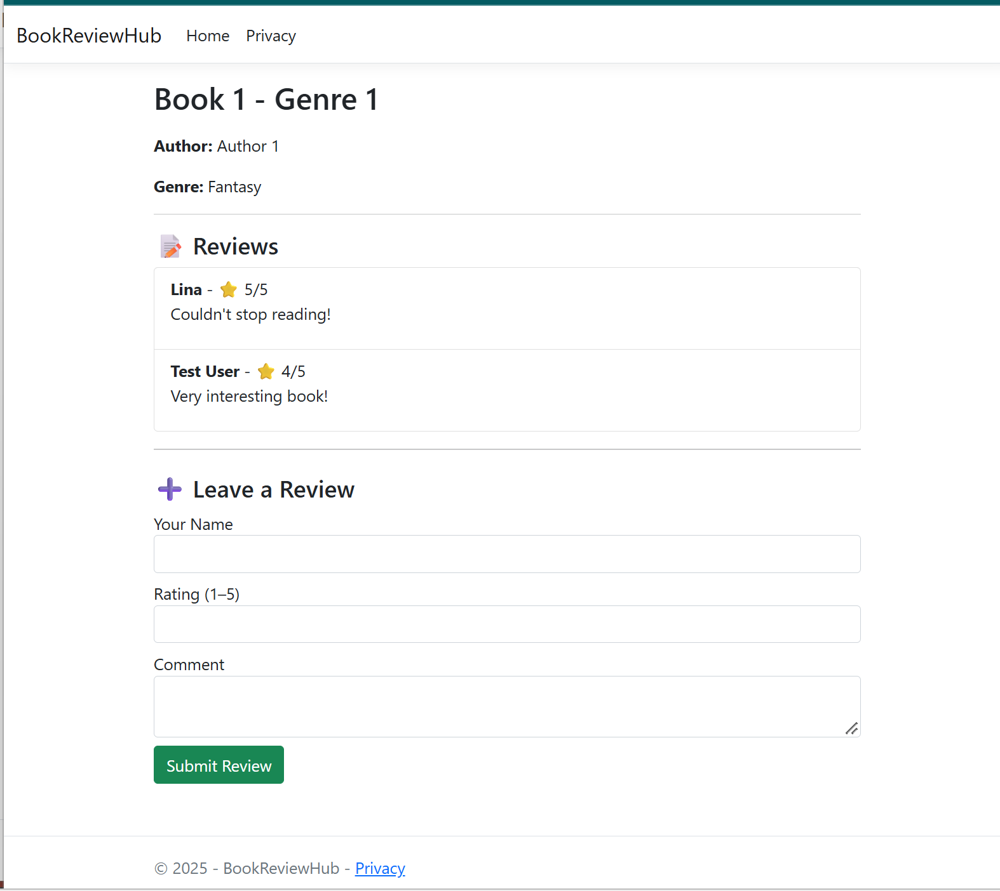

# 📚 Book Review Hub

A full-stack web application developed using ASP.NET Core MVC,
ASP.NET Core Web API, Entity Framework Core, and Microsoft SQL Server.

This project was developed as part of my Computer Science studies
at Atlantic Technological University (ATU), Ireland.

## 🎯 Project Overview

Book Review Hub is a web application designed to allow users
to browse books, submit reviews, and manage book-related information.

The project demonstrates my understanding of full-stack web
development, database integration, and RESTful API communication.

## 🛠️ Technologies Used

- C#
- ASP.NET Core MVC
- ASP.NET Core Web API
- Entity Framework Core
- Microsoft SQL Server
- HTML5
- CSS3
- Bootstrap
- JavaScript
- Visual Studio

## ✨ Main Features

- Browse book information
- Submit and manage book reviews
- Database integration using Entity Framework Core
- RESTful API communication
- Responsive web interface using Bootstrap
- MVC architecture for organising application components

## 🏗️ Project Structure

- Controllers — Handle application requests
- Models — Define application data structures
- Views — Provide the user interface
- Data — Manage database operations
- Migrations — Track database schema changes
- wwwroot — Store CSS, JavaScript, and other static files
- Program.cs — Configure the application

## 🎓 Skills Demonstrated

- Object-Oriented Programming (OOP)
- Full-stack web development
- ASP.NET Core MVC architecture
- RESTful API development
- Database design and management
- Entity Framework Core
- C# programming
- Problem-solving and debugging

## 👩‍💻 Developer

**Lina Venckus (Venckuviene)**

Computer Science Graduate  
Atlantic Technological University (ATU), Ireland

Interested in graduate and junior software development
opportunities, particularly in .NET, backend development,
and cloud technologies.

## 📸 Application Screenshot

The screenshot below shows the BookReviewHub application, including book details, submitted reviews, star ratings, and the review submission form.

